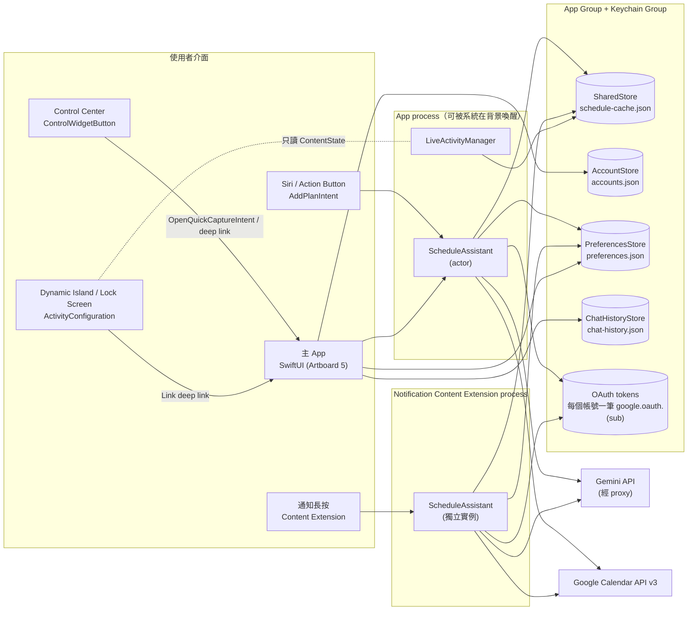
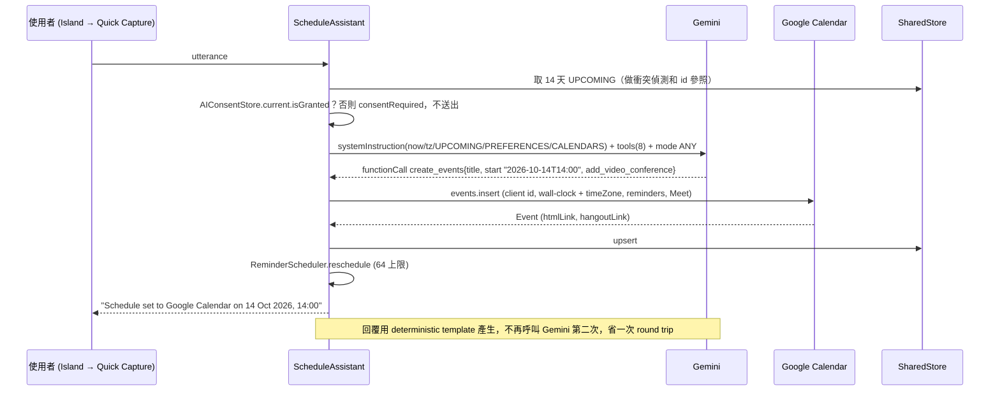

# Smart Schedules：系統架構與技術選型

> 核心理念：常駐背景、不打擾、輸入極快。
> 架構一句話：三個 process、一個 App Group、一條 AI 管線。凡是 iOS 不允許「原地」完成的事，都改成「看起來像原地」的路徑來完成。

---

## 1. 決定架構的平台限制

下表是設計圖與 iOS 實際行為的對照。每一列都直接改變了程式碼的寫法。

| 設計需求 | iOS 實際行為 | 本專案對策（檔案） |
|---|---|---|
| 從控制中心按時鐘圖示（Artboard 3 紅圈） | 直接打開 App 的快速輸入（鍵盤已叫出）。`ControlWidgetButton` 綁 `OpenQuickCaptureIntent`，照 Apple 文件做成 `OpenIntent`（參數 `target: QuickCaptureScreen`，只有 `.quickCapture`），同時編進 App 和 widget extension：系統把 App 帶到前景、在 App process 執行 `perform()`，把 `DeepLink.compose` 直接交給 `AppRouter`（`DeepLinkRequests`）。萬一仍在 widget extension 執行，連結先寫進 App Group 並發 `SharedChange.deepLink`，App 在收到通知、回到前景（和 0.5 秒後再看一次）、冷啟動第一個畫面時取走它（只取一次，3.1 節）。不再叫出動態島：沒有近期行程時那會是一個空白常駐的動態島，違反 Live Activity 只代表「即將發生或進行中」事件的規範 | `Shared/Intents/OpenQuickCaptureIntent.swift`、`Shared/Core/DeepLinkRequests.swift`、`Widgets/SmartScheduleControl.swift` |
| 動態島展開後有 TextField、麥克風、送出（Artboard 3） | Live Activity 只支援 `Button`、`Toggle`（App Intent）和 `Link`。不能放 TextField、叫不出鍵盤、不能捲動。Expanded 和 Lock Screen 的高度上限都是 160 pt | 展開的動態島左上角、鏡頭旁放一個小的「✎ 編輯」按鈕（`IslandEditPill`，`Link` 到 `DeepLink.compose`，島上唯一的控制項；點島上其他地方也一樣打開），不放輸入框、麥克風和送出鍵。點下去開啟 **Quick Capture**（Artboard 4）：一張外形像動態島、鍵盤已彈出的卡片，從島的位置放大出現。完全不開 App 的輸入改走 Siri、Action Button、Spotlight（`AddPlanIntent`）。2026-10-18 起底部不再有全寬的「編輯」按鈕（兩端會被島的圓角切到） |
| 動態島不常駐 | Live Activity 只能代表「即將發生或進行中」的事件（HIG、Guideline 4.2）；一個最多活躍 8 小時，之後在鎖定畫面再留最多 4 小時 | 一個行程一個 activity，開始前 30／15／10／5 分鐘出現、結束後 10 分鐘消失（`ActivityScheduler`，見 docs/NOTIFICATIONS.md §8） |
| 動態島顯示一週日曆（2026-10-18 起改成「接下來」的行程，同一天再改成只顯示這個行程和倒數進度條） | ActivityKit 的內容（static 加 dynamic）不能超過 4 KB。畫面渲染時不能連網，App 也不能每秒更新畫面。展開的島最高 160 pt，放進七天的週曆後字只剩 7–10 pt，看不清楚；「接下來」的時間欄在繁體中文（「明天 晚上 7:00」）被切掉 | 展開的島和鎖定畫面只顯示倒數的這個行程：標題、下面一行的時間和地點（`location`），底部是一條倒數進度條（`CountdownBar`，`ProgressView(timerInterval:countsDown:)`，系統自己會動，不用 App 更新）：只表示離開始還有多久（老闆 2026-10-18：「就單純是距離行程開始的時間」）：開始前從即時動態出現的時間（觸發時間，`ContentState.progressStart`）慢慢填滿，填滿就是開始（全長就是提前時間：iOS 18 在提前時間內才打開 App 時，出現時已經填了一段；出現後起點不變，改提前量不會讓進度條倒退或停住，`ActivityPlanner.keptProgressStart`）；進行中（或開始時間過了、內容過期）保持全滿，和倒數膠囊同時切換（`ContentState.progressRange`、`progressIsFull`）；結束後和沒有行程時沒有進度條。時間在顯示時才格式化，跟著 iPhone 的 12／24 小時制和設定 › 時區。`LiveActivityStateBuilder` 的標題最多 80 字、地點最多 40 字（截掉的結尾加「…」）；「接下來」的資料（`upNext`、`upNextMore`，最多 3 筆、標題最多 48 字）照樣產生，相容舊的 payload，之後也可以再拿來顯示，但畫面不顯示，改變時也不更新或替換即時動態。超過預算時先減少畫面不顯示的資料：週資料（`days`，為了相容舊的 payload 仍保留）和助理的最後一句，畫面上的內容因此不受助理回覆長短影響；再把「接下來」的標題截短到一個字都不留（畫面不顯示，所以之後的行程標題再長也不會讓地點變短）；還不夠才截短地點；都不夠時（一個字由很多 Unicode scalar 組成，例如很長的 emoji 序列）才按 scalar 截短標題、拿掉地點 |
| 「21 MIN」倒數 | 不靠推播也會自己跳動的文字，只有 `Text(timerInterval:)` 和日期樣式 | `countdownFrom`／`countdownTarget`，由 builder 保證範圍永遠合法 |
| 長按 Google 日曆送來的通知，原地展開（Artboard 1） | **App 不能擴充別的 App 的通知。** Google Calendar App 的推播，Smart Schedules 碰不到 | 改由 Smart Schedules 自己發提醒（本地通知或 APNs），並把 category 綁到 Content Extension。建議使用者關掉 Google Calendar iOS App 的通知（網頁和桌機上的 Google 彈窗照常保留） |
| 在通知裡直接輸入 | Content Extension 加上 `UNNotificationExtensionUserInteractionEnabled`，再用 `UNTextInputNotificationAction` 讓使用者打字。文字送出後，extension 內的 `didReceive(_:completionHandler:)` 直接處理，回傳 `.doNotDismiss` 讓卡片保持展開 | `NotificationContent/NotificationViewController.swift` |
| 前一天、24 小時、1 小時、30 分鐘前提醒 | 每個 App 最多只能有 64 個待發的本地通知，超過的會被**默默丟掉** | `ReminderScheduler` 採滾動視窗：只排最近的觸發點，留 2 格給貪睡。Routine 預設只提醒一次 |
| 和 Google 雙向同步 | BGAppRefresh 什麼時候跑由系統決定，不是即時通道 | `SyncEngine`：寫入失敗先進 App Group 待送佇列（連線、前景、BG refresh 時依序補送），修改帶 If-Match 防覆蓋；App 開著時每 60 秒抓「之後有變動的」，在抽屜的同步狀態列點一下、BG refresh（最早 15 分鐘）時整段重抓（主畫面沒有下拉重新整理，見 GOOGLE_CALENDAR_SYNC.md §10.1）。要即時：後端 `events.watch`（webhook），再發 silent push 或遠端提醒（見 GOOGLE_CALENDAR_SYNC.md §10） |
| 在 App 內呼叫 Gemini | 打包進 IPA 的 API key 幾分鐘就能被挖出來 | App 裡沒有 key：經 Smart Schedules 的 Cloudflare Worker（`server/worker/`）呼叫，Worker 驗證 App Attest、依金鑰限流後加上 key 轉給 Google。`GEMINI_BASE_URL` 指向 Worker |
| Gemini 模型版本 | 2.5 系列已經過了公告的最早關機日（2026-10-16）；3.x 的模型 ID 換得很快 | `GEMINI_MODEL_ID` 由 xcconfig 注入，預設 `gemini-3.8-flash`（2026-10-17 起）。**上線前務必到 deprecations 頁確認**。換模型時先把新 ID 加進 Worker 的 `SESSION_MODELS` 並部署（舊 ID 留到舊版 App 不再使用），否則通知擴充的回覆會被拒（403 `session_scope`） |
| Gemini 3 多輪 function calling | 要把 thought signature 原樣傳回，否則回 400 | `GeminiTurn` 把模型回傳的 content 以 raw JSON 原封保存（`Shared/AI/GeminiClient.swift`） |
| 把個人資料傳給第三方 AI 前要先說明並取得同意（App Store 5.1.2(i)，2025 年 11 月） | 審核會在乾淨安裝、Siri、通知擴充裡各試一次 | `GeminiClient.generate` 在組 request 之前先檢查 `AIConsentStore.current.isGranted`，沒有同意就丟 `GeminiError.consentRequired`，一個閘門蓋住所有入口。App 顯示同意說明（`App/Views/Chat/AIConsentSheet.swift`），Siri 和通知改成告訴使用者到設定開啟。Demo 模式同樣經過這道閘門；沒有同意或 AI 無法使用時改用 DemoAssistant 的離線規則 |
| 動態島「在每個行程開始前自動出現」 | App 在背景不能 `Activity.request()` | iOS 26：`Activity.request(…, start:)` 排程啟動。iOS 18：1.0 只在 App 執行時開始（提前時間內或行程進行中打開 App），之後關掉 App 也留著。APNs push-to-start（`PushToStartRegistrar` 準備好整份資料，伺服器在觸發時間送出）的程式碼保留給之後的版本，1.0 關閉（`AppConstants.pushToStartEnabled = false`：不要 token、不上傳、沒有 `aps-environment`） |
| 從 App 打開系統的專注模式設定 | 沒有公開的 URL 可以直接開到「專注模式」 | 提供 `SetFocusFilterIntent`（`App/Intents/CalendarFocusFilter.swift`），設定頁用文字說明路徑：設定 › 專注模式 › 選一個 › 加入過濾條件 › Smart Schedules |
| App 介面語言 | iOS 自己管理每個 App 的語言，App 不能自行切換 | 設定 › 語言打開 `UIApplication.openSettingsURLString`（系統設定裡這個 App 的頁面） |
| 控制中心、Action Button、鎖定畫面控制項、Siri 片語 | 只有使用者自己能加入，App 無法代勞 | 設定 › 捷徑與 Siri 寫出每一種的步驟（`ShortcutsGuideView`） |

---

## 2. Process 與資料邊界

**為什麼有三個 target：**
| Target | 內容 | 不放進其他 target 的理由 |
|---|---|---|
| `SmartSchedule`（App） | SwiftUI 主畫面、Quick Capture、Google 登入（PKCE）、語音輸入（只在 iPhone 上辨識）、BGTask、App Intents | `ASWebAuthenticationSession` 和 `UIApplication` 在 extension 裡不能用；麥克風只給 App，兩個 extension 都沒有 |
| `SmartScheduleWidgets` | Live Activity（動態島＋鎖定畫面）、Control Center 控制項 | Widget extension 有記憶體上限，所以只編譯 Models、Storage、LiveActivity、Intents、DesignSystem，不放 AI 和網路程式碼 |
| `SmartScheduleNotificationContent` | 「長按展開」的對話 UI 和完整的 AI → Calendar 管線 | 必須能在鎖定畫面上獨立完成寫入（iPhone 鎖定時會先要求 Face ID／密碼；Gemini 要用 App 在 7 天內替它換好的 session，見 3.3） |

**跨 process 共享：**
- **App Group**（`group.com.smartschedule.shared`）：放 `SharedStore`，一個 JSON 檔，每次存取都包在 `NSFileCoordinator` 裡。檔案大約 50 到 150 KB；profiling 證明有瓶頸才換成 SQLite。
- **Keychain access group**：存 OAuth refresh token，屬性設 `kSecAttrAccessibleAfterFirstUnlock`，這樣鎖定畫面上的 extension 也讀得到。
- **Extension 寫入後，Live Activity 不會立刻更新**：extension 改不了 App 的 activity。要等下次 App 被喚醒（BG refresh、Control、Siri），或由後端發 Live Activity push。
- **其他 App Group 檔案**：`accounts.json`（帳號、行事曆、這台裝置上的顯示／顏色／提醒設定、專注模式過濾條件）、`preferences.json`（設定、「助理記得的事」、學到的建議、略過提醒的次數）、`chat-history.json`（App 的對話，最多 200 則）。AI 同意存在 App Group 的 UserDefaults（`SSAIConsent`），可以同步讀取。
- **跨 process 變更通知**：寫入設定、帳號或同意狀態的 process 會發 Darwin notification（`SharedChangeNotifier`，名稱 `com.smartschedule.changed.preferences|accounts|consent|syncStatus|deepLink`），其他 process 收到後重新讀取。App 裡 `ScheduleViewModel` 在設定變更時重建 `WallClock`（時區、每週起始日）、重排提醒、更新 Live Activity；帳號變更時重新讀取帳號和可見行程。

---

## 3. 各介面的框架選型

### 3.1 控制中心：WidgetKit `ControlWidget`（iOS 18+）
- `StaticControlConfiguration` 搭配 `ControlWidgetButton(action: OpenQuickCaptureIntent())`：打開 App 停在快速輸入。Apple 的「Creating controls to perform actions across the system」：要用控制項打開 App 的某個畫面，action 要是 `OpenIntent`，而且 intent 的 Target Membership 要同時勾 App 和 widget extension。
- 控制項只能顯示 SF Symbol 或自訂 symbol（`.symbolset`）。要和 App icon 的時鐘一模一樣，得把它匯出成 custom symbol。
- 同一個控制項可以放進控制中心、鎖定畫面左下和右下的按鈕位，以及 Action Button。
- 控制項的 intent 不啟動 Live Activity。
- **為什麼是 `OpenIntent`**：第一版用普通 `AppIntent` 加 `openAppWhenRun = true`（iOS 26 再加 `supportedModes = .foreground(.immediate)`）。實機 iOS 26 上，用 Xcode 的 Run 裝的時候正常；改用 `xcodebuild` 加 `xcrun devicectl device install app` 安裝（沒有 debugger，和 App Store 安裝一樣）之後，按下去控制中心停約 3.5 秒、App 閃一下黑畫面又回到主畫面，再按一次 App 打開了卻停在主畫面。Apple 文件寫明：`openAppWhenRun` 在 iOS 26 SDK 棄用，「Setting this property to `true` generates an error if the app intent runs in an app extension」；而「For WidgetKit controls in a Widget extension, the system runs the control's app intent from the extension in the background」。Apple 也說系統「might run it from your app if the app is already running」，而 debugger 讓 App 不會被暫停。可能的原因有兩個，可能同時存在：（1）沒有 debugger 時 App 沒在跑，intent 改在 widget extension 執行、出錯，`perform()` 沒有執行，連結從沒寫出去；（2）「閃一下黑畫面又回到主畫面」是 App 被 intent 啟動時當機（見下面「App 被 intent 啟動時會當機」），開發者論壇 775497 描述的就是這個畫面。兩者都還沒用實機的 crash log 或 Console 的 `QuickCapture` 那一行證實。`OpenIntent` 由系統自動設成在前景執行（「The system automatically brings your app to the foreground to run this app intent」），不再宣告 `openAppWhenRun` 和 `supportedModes`。
- **App process（正常路徑）**：App 啟動時 `DeepLinkRequests.install` 裝好的 handler 直接呼叫 `AppRouter.handle(DeepLink.compose)`。handler 在 `SmartScheduleApp.init` 裝好；萬一 intent 比它早執行，`open` 會走下面的備援，冷啟動的 `.task` 一樣取得到。
- **widget extension（備援）**：沒有 handler，所以：
  1. `DeepLinkRequests.open` 把連結和時間寫進 App Group（`deepLink.pendingURL`／`pendingDate`，60 秒內有效），`synchronize()` 後發 Darwin notification `SharedChange.deepLink`。
  2. App 在三個時機呼叫 `DeepLinkRequests.routePending`：`AppDelegate` 收到 `.deepLink` 而且不在背景時；scene 變成 `.active` 時，當下沒有的話 `lateWriteDelay`（0.5 秒）後再看一次；冷啟動 `RootView` 的 `.task` 一開始。寫入比 App 到前景早或晚都接得到。
  3. `takePending` 讀到就刪掉，所以三個時機只有第一個打開快速輸入，不會打開兩次。
- `target` 在 `init()` 裡設成 `.quickCapture`，`@Parameter` 也有同樣的預設值：控制項存下的 action 一定帶著它（還要使用者回答參數的 intent 從控制項不會執行）。Siri／捷徑的「Open Quick Capture in Smart Schedules」是同一個 intent（`SmartScheduleShortcuts`），不會多問一個問題（這句話目前只有英文，Siri 要設成英文）。
- 診斷：`perform()` 先交出連結，再在 Console.app 記一行（subsystem `com.smartschedules.app`，category `QuickCapture`）：在哪個 process 執行（`com.smartschedules.app` 或 `com.smartschedules.app.widgets`）。不讀 `systemContext`，交出連結前不做任何別的事。
- **App 被 intent 啟動時會當機（2026-10-19，b9bc912）**：老闆 2026-10-19 在 iOS 26 實機確認 `1d70c42`（OpenIntent、背景更新改在 `didFinishLaunching` 註冊，並把 Quick Capture 的 DAY 改回 10/18 改版前的設計）從控制中心打開快速輸入正常。三項改動在同一版，沒有分開測，所以哪一項是關鍵沒有定論。OpenIntent 的版本按下去 App 打開、沒有快速輸入、接著整個 App 當機。最可能的原因：SwiftUI 的 `.backgroundTask(.appRefresh)` 有時在啟動完成之後才向 BGTaskScheduler 註冊，丟出「All launch handlers must be registered before application finishes launching」。Apple DTS 在開發者論壇 775182 證實是 SwiftUI 的問題，同一串有人回報從多工畫面滑掉 App 後按控制中心按鈕或捷徑「幾乎每次」都當；775497 是 App 上有 `@Environment(\.scenePhase)` 加 `.backgroundTask` 時啟動就當（「畫面暗一下，App 沒有打開」），這個 App 正是這樣寫。DTS 的建議做法就是 b9bc912：背景更新改在 `didFinishLaunching` 第一行註冊（見 3.4 節「背景工作」）。DTS 說 iOS 18.5b2 修過一次，iOS 26 是否仍會發生沒有公開報告；確認方法見第 7 節的 crash log 步驟。
- **要在實機上驗證**（第 7 節）：按下後停在快速輸入、鍵盤已叫出，動態島沒有新的 activity。
- **先停在主畫面約 1.7 秒（2026-10-19 老闆的螢幕錄影）**：0.7 秒按下，2.0 秒 App 的主畫面出現，停到 3.7 秒快速輸入才放大出現（放大本身約 0.2 秒）。原因是 `OpenIntent` 的設計：Apple「Configuring the runtime behavior of your app intents」寫「The system runs this method after bringing your app to the foreground」，所以 `perform()` 打開的東西一定在主畫面之後；中間多久由系統決定（冷啟動、主執行緒忙都會拉長），Apple 沒有給數字。App 這邊從 `perform()` 到 `AppRouter.handle` 是同步的，沒有等待。
- **iOS 26 的修法：intent 先送到 scene**（Apple「Directing app intents to your app's scenes」）：
  1. `OpenQuickCaptureIntent` 加上 iOS 26 才有的 `TargetContentProvidingIntent`（預設的 `contentIdentifier`，也就是型別名稱）。
  2. `RootView` 掛 `QuickCaptureSceneRouting`（`onAppIntentExecution(OpenQuickCaptureIntent.self)`）：「Your closure runs before the app comes to the foreground and before the system calls the app intent's perform() method」，在這裡呼叫 `AppRouter.openQuickCaptureFromScene()`，所以 App 出現時第一個畫面就是快速輸入。`handlesExternalEvents(preferring: [], allowing: ["*"])` 讓唯一的 scene 接所有連結和 intent，iOS 不會另開 scene。
  3. App 的 Info.plist 加 `UIApplicationSceneManifest › UIApplicationSupportsMultipleScenes = YES`：「The App Intents framework requires support for multiple scenes to dispatch app intents to your scene at launch time」。App 還是只有一個 scene。
  4. 之後系統照樣呼叫 `perform()`：`AppRouter.handleIntentLink` 用 `DeepLinkRequests.isSceneEcho` 認出是同一次按下（60 秒內，和 App Group 備援的有效時間一樣；`DeepLink.compose`），略過一次，所以使用者剛關掉的快速輸入不會又跳出來。App Group 備援（`routePending`）也走同一個檢查。動態島的連結（`onOpenURL`）不受影響。
  5. 快速輸入可能在 App 還在背景準備時就出現，那時叫不起鍵盤，所以 `QuickCaptureView` 這時先不叫，等 App 第一次變成 `.active` 才叫。
  6. iOS 18 沒有這些 API，照舊由 `perform()` 打開（主畫面會先出現一下）。三個部分少一個就會默默回到舊行為，`scripts/validate_schema.py` 第 13 項檢查三者都在。
- **時間紀錄**：Console.app › iPhone › subsystem `com.smartschedules.app`、category `Launch`，依序記 `App init`、`didFinishLaunching`、`Scene active`、`First task`、`Open Quick Capture (from scene｜perform｜url｜pending …)`、`… skipped`、`Quick Capture on screen`。不用 debugger 就能看出是哪一條路打開、各花多久。終端機收集方式見第 7 節。

### 3.2 動態島：ActivityKit 加 WidgetKit `ActivityConfiguration`
- 版面配置（`Widgets/ScheduleLiveActivity.swift`）：
  - Compact：⏰ 加短標題（leading），倒數（trailing）。
  - Expanded：`.leading` 放「✎ 編輯」小膠囊（`IslandEditPill`，`Link` 到 `DeepLink.compose`，島上唯一的控制項，點島上其他地方也一樣打開快速輸入）、`.trailing` 放「21 MIN」倒數膠囊（兩個膠囊離島的角落再往內 4 pt、往下 2 pt，外框用 `strokeBorder` 畫在內側）；`.center` 放標題和下一行的時間・地點；`.bottom` 放倒數進度條（`CountdownBar`：白色、6 pt 高、圓角，左右比內容邊距再往內 12 pt（`barSideInset`，避開底部圓角；鎖定畫面上是全寬），開始前從觸發時間慢慢填滿到開始，進行中保持全滿；沒有點擊目標；結束後或沒有倒數行程時底部是空的，島會縮小）。
  - Minimal：只有 ⏰。
- 互動：`Link` 用於 deep link（「編輯」按鈕 → `smartschedule://compose`；動態島沒有麥克風；App 仍接受 `?mode=voice`（`DeepLink.composeVoice`）：打開快速輸入，不必跳權限提示就能收音時直接開始語音輸入，否則和 `compose` 一樣叫出鍵盤；上面有 sheet 或行程頁時也只叫出鍵盤，抽屜會先關掉）；`Button(intent:)` 用於不開 App 的動作。
- 推播：`pushType: .token` 搭配 `NSSupportsLiveActivitiesFrequentUpdates`；APNs 的 `apns-push-type: liveactivity`，topic 是 `<bundle>.push-type.liveactivity`。1.0 不用任何推播：`AppConstants.liveActivityPushEnabled` 和 `pushToStartEnabled` 都是 false，`Activity.request` 用 `pushType: nil`，App 沒有 `aps-environment` 也沒有 `remote-notification` 背景模式。

### 3.3 通知：UserNotificationsUI Content Extension
- 細節見 [`NOTIFICATIONS.md`](NOTIFICATIONS.md)。
- 長按通知後的對話、改時間、紅色確認刪除，都在 extension 裡直接呼叫 Gemini 與 Google Calendar 完成（不丟給 BGTask：系統可能數小時後才執行）。Extension 的網路走 `NetworkSession`（`Shared/Core/NetworkSession.swift`）：`.ephemeral`（不寫磁碟快取、cookie、憑證），每個 request 最多等 30 秒；主 App 仍用 `URLSession.shared`。兩次小型 JSON 請求遠低於 extension 的記憶體上限。
- Extension 呼叫 Gemini 一樣經過 Smart Schedules 的伺服器，但 App Attest 在 app extension 裡不能用，所以它送的是 App 替它要來、放在共用 Keychain 的 session token（`Authorization: Session …`，7 天，伺服器只接受它呼叫 Gemini）。App 太久沒打開時 token 會過期，擴充就請使用者打開 App 一次（`Shared/Security/AppAttestClient.swift`）。
- 如果改用遠端推播，可以另加 Notification Service Extension（`mutable-content: 1`），在送達前補上 category 和最新資料。

### 3.4 主 App：SwiftUI 加 Observation（`@Observable`）
- iOS 18 起跳。`RootView` 疊出 Quick Capture overlay，動畫是 `.scale(anchor: .top)`，看起來像從動態島「長」出來。
- 背景工作：`BGTaskScheduler.shared.register` 在 `AppDelegate` 的 `didFinishLaunching` 第一行註冊一次（`AppRefresh.registerHandler`），identifier 必須是 `BGTaskSchedulerPermittedIdentifiers` 裡唯一的那一個。不用 SwiftUI 的 `.backgroundTask(.appRefresh(...))`：Apple DTS 證實 SwiftUI 有時在啟動完成後才註冊，App 會當機（開發者論壇 775182、775497；779354 是另一個自己診斷的回報）。這最可能就是控制中心按鈕啟動 App 時的當機（3.1 節）。`scripts/validate_schema.py` 第 11 項檢查：沒有 `.backgroundTask`、只註冊一次、是 `didFinishLaunching` 的第一行、identifier 和 Info.plist 一致。
- **Artboard 5 的導覽**：漢堡選單 = 看什麼（`CalendarDrawer`，從左邊滑出，內含自己的 `NavigationStack`，行事曆設定在抽屜裡推入）；頭像 = 我是誰（`AccountSheet`：Google 帳號；Smart Schedules Pro 區塊在 1.0 關閉）；General = App 怎麼運作（`SettingsView`）。`AppRouter` 管抽屜開關和這兩個 sheet，也接受 `smartschedule://settings`、`smartschedule://accounts`。月份 chips 和月曆格維持無限捲動；時區或每週起始日改變時，用 `.id(schedule.clockID)` 讓它們以 `displayedMonth` 重新排版。
- **View model**：`ScheduleViewModel`（可見行程、帳號、待確認的計畫和「先問我」行程、`clock`）、`ChatViewModel`（對話、卡片狀態、AI 同意流程、對話紀錄的讀寫）、`SettingsModel`（設定頁的偏好、紀錄、建議、同意狀態；每次修改都經過 `PreferencesStore.update(source: .settings)`，自動記進「助理記得的事」）。
- **語音輸入**（2026-10-18 加回，免費）：主畫面對話和快速輸入的輸入列（`ComposerBar`）有麥克風按鈕，由 `App/Voice/VoiceTranscriber.swift` 用 `SFSpeechRecognizer` 辨識中文（台灣）或美式英文（設定 › 助理 › 語音辨識語言，「自動」跟著 App 的語言；規則在 `Shared/Voice/VoiceInput.swift`）。每個 `SFSpeechAudioBufferRecognitionRequest` 都設 `requiresOnDeviceRecognition = true`，只在 iPhone 上辨識、不用 Apple 的伺服器；這支 iPhone 不支援該語言的裝置端辨識時不顯示按鈕（鍵盤的聽寫照常可用）；辨識器的 delegate（`availabilityDidChange`）在畫面開著時更新按鈕，例如裝置端模型下載完。音訊只在記憶體裡交給辨識器，不寫檔、不上傳；辨識到的字填進輸入框，按「傳送」才送出。再按一次、按傳送、離開畫面、被蓋住（主畫面對話上面開了快速輸入、抽屜、sheet 或行程頁）、App 退到背景、靜默 3 秒（還沒聽到字時 8 秒）或滿 60 秒就停；輸入框被清空（傳送、點建議、另一個輸入列送出、清除對話紀錄）時也停，還在路上的字丟掉，不會再填回去。麥克風和語音辨識權限只在第一次按麥克風時詢問；被拒絕後按麥克風會說明要開哪個開關，並可打開「設定」。`scripts/validate_schema.py` 第 9 項檢查這些規則和 usage description 只在 App target。
- **啟動順序**：先讀回對話紀錄 → `ScheduleViewModel.bootstrap()`（舊版單一帳號搬到多帳號 → 帳號 → 快取 → 同步）→ 對齊 App Group 裡的草稿和「先問我」批次 → 加入學到的建議卡片 → `summonIfDue`。回到前景時另外重新整理行事曆清單（超過 6 小時的）。通知權限不在第一次啟動時問：示範模式開始（種範例資料之前）或第一次連上 Google 帳號後才問（`ScheduleViewModel.requestNotificationPermissionIfNeeded`）；已經登入或在示範模式、卻從沒被問過的人（例如問到一半 App 被關掉），啟動時補問一次。

### 3.5 零 UI 輸入：App Intents
- `AddPlanIntent`：用 `@Parameter` 搭配 `requestValueDialog`，由 Siri 或 Shortcuts 開口問「What should I schedule?」，全程不開 App。
- `AppShortcutsProvider` 讓 Spotlight 和 Siri 不用設定就能叫出來。指派給 Action Button，就是一顆實體的「排程鍵」。

### 3.6 AI：Gemini REST function calling
- 細節見 [`GEMINI_FUNCTION_CALLING.md`](GEMINI_FUNCTION_CALLING.md)。
- 不依賴任何 SDK，所以 notification extension 也能直接用同一份 client。

### 3.7 行事曆：Google Calendar API v3 REST 加 OAuth PKCE
- 細節見 [`GOOGLE_CALENDAR_SYNC.md`](GOOGLE_CALENDAR_SYNC.md)。
- 不用 GoogleSignIn SDK：用 `ASWebAuthenticationSession` 加 PKCE 登入，refresh 就是一個表單 POST，任何 process 都能做。

### 3.8 設定、帳號、同意與偏好的資料流

規格在 [`SETTINGS.md`](SETTINGS.md)；這裡只說資料怎麼流動。

- **帳號**：新增帳號頁讓使用者輸入 email，`AccountManager.addAccount(email:)` 把它當 `login_hint` 用 `GoogleSignInCoordinator.signIn(loginHint:)` 登入（沒有輸入時 `prompt=consent select_account`，scope 多了 `calendar.calendarlist.readonly`），登入的帳號和輸入的 email 不同時先不存，從 ID token 取出 `sub` 和 email，token 存成 Keychain 的 `google.oauth.`，帳號和行事曆清單存進 `AccountStore`（`accounts.json`）。舊版的單一 `google.oauth` 會在 `bootstrap()` 第一步搬過去（`migrateLegacyAccountIfNeeded`）。某個帳號的 refresh token 失效時只把那個帳號標成 `needsReconnect`，其他帳號照常同步。
- **同步**：`CalendarSync` 對每個帳號的每個行事曆各自重列 −7～+120 天（最多同時 4 個），失敗只影響那個行事曆；快取裡的行程以 `EventRef`（帳號、行事曆、id）區分。畫面、提醒和 Live Activity 都讀 `SharedStore.visibleEvents`，由 `EventVisibility` 套用隱藏的行事曆、關掉提醒的行事曆、專注模式過濾條件和示範模式，並把同一個會議在兩個帳號的副本合成一個（主辦人的副本優先）。
- **寫入**：所有寫入都經過 `CalendarRouter`。新行程寫到預設行事曆（設定 › 行事曆與新行程，或告訴助理「以後用學校帳號」），修改和刪除寫到該副本自己的行事曆；唯讀行事曆在送出 request 前就回 `RouterError.readOnly`。
- **偏好設定**：`PreferencesStore`（`preferences.json`）是唯一來源，`current()` 可以同步讀取，所以 `WallClock()`、`ReminderPolicy(preferences:)`、mapper 都在每次使用時讀最新的值。設定頁經過 `SettingsModel` → `PreferencesStore.update(source: .settings)`；在對話裡改的經過 `update_preferences` → `PreferencesStore.apply`（同一套驗證）。兩條路都會在「助理記得的事」留一行（每個 key 最多一行，回到預設值就移除），回傳的 receipt 讓對話卡片可以復原。寫入後發 `.preferences` 變更通知：`ScheduleViewModel` 重建 `WallClock`、`ReminderScheduler.reschedule()`（由 `ReminderPlanner` 決定提醒來源、緊急程度、安靜時段、每日摘要和每日上限）、更新 Live Activity。
- **AI 同意**：`AIConsentStore`（App Group UserDefaults `SSAIConsent`，含說明文字的版本）是 `GeminiClient.generate` 唯一的閘門。App 第一次送出訊息時顯示同意說明，按「允許」後原訊息直接送出；Siri 和通知擴充只回一句「請到設定開啟」。撤回或拒絕後，設定和輸入列上方的提示列可以重新開啟。送給 Gemini 的行事曆和帳號都經過 `CalendarAliases`（「My calendar | Account 2」），不含 Google 帳號的 email；使用者的訊息、行程文字和錯誤訊息裡的帳號 email 也先換成佔位字，模型寫回來的佔位字在 iPhone 上換回地址；移除帳號時清掉助理的對話，因為後面帳號的編號會變（`docs/GEMINI_FUNCTION_CALLING.md` §10.6）。
- **訂閱、匯出、清除**：`SubscriptionStore`（StoreKit 2，只提供 `isPro`；1.0 不賣訂閱，`AppConstants.subscriptionsEnabled = false` 讓啟動時不呼叫 StoreKit、頭像頁沒有 Pro 區塊；程式碼留在二進位檔裡但執行不到，計畫在 1.1 的 AI 訂閱打開，見 `docs/SETTINGS.md` §16）；`DataExporter` 匯出設定、紀錄、帳號的行事曆名稱、快取行程和對話（不含 token）；`DataEraser` 依序取消通知、結束 Live Activity、撤銷並刪除每個帳號的 token、清掉所有 App Group 檔案和匯出的暫存檔。

---

## 4. 端到端流程：「明天下午兩點跟 Joe 開線上會議」

**長期計畫多一步審閱：** `create_long_term_plan` 只產生草稿（`PlanDraft`，存在 `SharedStore.pendingPlan`），App 顯示計畫卡片和日曆預覽，什麼都還沒寫進 Google。使用者按 **Add** 才由 `commitPlan` 寫入；按 **Keep editing** 就說要改什麼，Gemini 回一份完整的修訂版（同一個 plan id、revision 加 1），再給同樣的兩個按鈕，直到 Add 為止。打字「好」「looks good」等同 Add（`confirm_plan add`），「不要了」會丟棄草稿（`confirm_plan discard`）。單一事件預設照舊立刻寫入；設定 › 助理選「先問我」時，單一事件也先停在「尚未加入行事曆」卡片（`PendingEventBatch`，App Group 單一欄位，Siri 和通知擴充共用），按「加入」才寫入。細節見 [`GEMINI_FUNCTION_CALLING.md`](GEMINI_FUNCTION_CALLING.md) 第 5 節和 [`SETTINGS.md`](SETTINGS.md) 第 6 節。

**用一句話改設定：** 「以後」「從現在開始」「別再」這類長期指示走第 8 個函式 `update_preferences`。App 驗證後套用，對話裡出現「設定已更新」卡片（可以復原），並記進「助理記得的事」。只針對某一個行程的提醒仍然用 `modify_event`／`create_events`。

**延遲預算（目標值，要在實機上量）：** Gemini Flash（`thinkingLevel: low`）約 1 到 2.5 秒，Calendar insert 約 0.3 到 0.7 秒，本地處理不到 50 毫秒，總計目標不超過 3 秒。長期計畫是 4 路並行 insert，每多一批 4 個 series 大約多 0.5 秒。

---

## 5. 安全與可靠性

| 風險 | 對策 |
|---|---|
| API key 外洩 | key 只在 Cloudflare Worker。Worker 驗證 App Attest（DeviceCheck framework）的 attestation 與每個 request 的 assertion，依金鑰限流；通知擴充的 session token 只能呼叫 App 用的那個模型的 generateContent |
| Prompt injection（別人寄來的邀請，標題裡寫指令） | 行事曆資料放在 system prompt 的 DATA 區塊，並移除分隔字元；模型只能呼叫 8 個白名單函式；`modify_event`／`delete_events` 的 id 一定要在本地 cache 裡找得到才放行；批次刪除要使用者按確認；`update_preferences` 只接受列舉的 key，值逐一驗證，改了什麼都顯示在卡片上並可復原 |
| 個人資料送到 Gemini | 第一次使用前說明並取得同意，設定裡可以撤回（見第 1 節）。不宣稱「不用於訓練」：那只在 Gemini 付費層級成立，上線前要開 Cloud Billing |
| 刪除資料（沒有自己的帳號系統） | 每個 Google 帳號可以「移除帳號」：撤銷授權（`oauth2.googleapis.com/revoke`）、刪除 Keychain token、清掉該帳號的快取行程。「清除這台裝置上的所有資料」再加上設定、對話紀錄、待發通知、Live Activity。1.0 沒有訂閱；1.1 計畫加入的 AI 訂閱屬於 Apple 帳號，不受影響 |
| 網路重試造成重複事件 | Event ID 由確定的 seed 算出（base32hex）；伺服器回 409 就當作已經寫過 |
| Token 過期 | OAuth consent screen 在 Testing 狀態時，refresh token **7 天就失效**。`calendar.events` 屬於 sensitive scope，正式上線要過 Google 的 App 驗證 |
| 跨 process 同時寫檔 | 用 `NSFileCoordinator` 加 atomic write |

---

## 6. 打破框架的建議（可選）

1. **用通知當鍵盤（完全不開 App 的動態島輸入）。** 動態島上的 `Button(intent:)` 觸發一個 `LiveActivityIntent`，它發出一則 `SS_COMPOSE` 通知；使用者把通知往下拉，直接用系統輸入框打字，回覆由 Content Extension 原地處理。代價是比 deep link 多一個手勢，換來的是 App **永遠不會出現**。適合做成「隱形模式」開關。
2. **雙引擎解析。** iOS 26 有 Apple 的 Foundation Models（裝置上約 3B 參數，支援 guided generation 和 tool calling）。單一事件交給它解析：離線、零成本、延遲在 1 秒內。只有長期計畫才送 Gemini。雲端費用和延遲可以降一個數量級。限制：只支援有 Apple Intelligence 的機型。
3. **EventKit 混合同步。** Artboard 1 頂部那行字其實就是 EventKit 權限說明。如果使用者已經在 iOS 設定裡加了 Google 帳號，EventKit 的讀取是即時且離線的，還有 `EKEventStoreChanged` 通知，等於不用後端就有接近即時的反向同步。Google API 只負責 EventKit 做不到的寫入：Meet 連結、`extendedProperties`、idempotent ID。
4. **自我修正的計畫。** 把每次的 milestone 當成回饋點：使用者在通知裡回「這週只練了 2 次」，Gemini 就用 `modify_event`（`all_occurrences`）重排接下來的那一段。「計畫」從一次性產出變成一個閉環控制系統。
5. **把動態島當作決策佇列，而不只是下一個行程。** 例如顯示「回覆 Joe？」並附上「是／稍後」按鈕（`Button(intent:)`）。把島上的空間留給「下一個需要你決定的事」，這才真正做到不打擾：只在需要你時出現。
6. **提醒等級隨期限升級。** deadline 類事件的 `interruptionLevel` 依剩餘時間調整：還早時用 `.passive`，接近時用 `.active`，最後一小時用 `.timeSensitive`。讓 Focus 模式替你過濾干擾，而不是你去過濾 App。

---

## 7. 只能在實機上驗證的項目

- [ ] 控制中心 → `OpenQuickCaptureIntent` 打開快速輸入、鍵盤已叫出（已鎖定和未鎖定都要測），動態島沒有新的 activity。**一定要用沒有 debugger 的 build 測**：`xcodebuild` 加 `xcrun devicectl device install app`、TestFlight，或在 Xcode 按 Run 之後按 Stop 再從主畫面打開；按著 Run 測不出問題（App 一直活著）。換 intent 的型別之後，先把控制中心裡的按鈕移除再加回來。iOS 18 和 iOS 26 各測三種狀態：App 沒在執行（從 App 切換器滑掉）、App 在背景、App 開著（在 App 裡拉下控制中心再按）。若仍停在主畫面或當機：先看 iPhone 的設定 › 隱私權與安全性 › 分析與改進功能 › 分析資料，最新的 `SmartSchedule-…` 報告若有「All launch handlers must be registered」或 `AppRefreshBackgroundTask.register`，就是 3.1 節的啟動當機；再在 Console.app 看 `QuickCapture` 那一行是哪個 process（沒有這一行代表 `perform()` 沒有執行）；再於 60 秒內切出去再回到 App，若這時才出現快速輸入，代表連結有寫入但沒收到 `.deepLink`。也從 Siri 說「Open Quick Capture in Smart Schedules」測一次。
- [ ] iOS 26：控制中心按下後，App 出現時**第一個畫面就是快速輸入**（不再先停在主畫面），鍵盤在 App 到前景時叫出；關掉快速輸入後幾秒內不會自己再跳出來。三種狀態都錄影。動態島的「編輯」和 Google 登入各試一次（Info.plist 多了 `UIApplicationSupportsMultipleScenes`）。iOS 18 維持原樣（主畫面先出現一下）。時間紀錄（Mac 終端機，iPhone 接著並解鎖）：`xcrun devicectl list devices` 取得 iPhone 的識別碼，按完控制中心後執行 `sudo log collect --device-udid <識別碼> --last 3m --output ~/Desktop/qc.logarchive`，再 `log show ~/Desktop/qc.logarchive --style compact --predicate 'subsystem == "com.smartschedules.app" AND (category == "Launch" OR category == "QuickCapture")'`；應該看到 `Open Quick Capture (from scene)` 在 `perform()` 那一行之前，後面接著 `perform skipped`。
- [ ] 背景更新（b9bc912 起自己註冊）：在 Xcode 跑起來、按 Home 鍵讓 App 進背景、在 debugger 暫停後執行 `e -l objc -- (void)[[BGTaskScheduler sharedScheduler] _simulateLaunchForTaskWithIdentifier:@"com.smartschedule.refresh"]`，繼續執行，確認有同步、有送出下一次的 request；再用 `_simulateExpirationForTaskWithIdentifier:` 確認到期時 App 沒有被系統停掉。
- [ ] iOS 26：App 關著時，`Activity.request(…, start:)` 排程的 activity 在提前量準時出現（1.0 的 build 沒有 `aps-environment`，也要準時出現）；同時排 10／20／50 筆，記下第幾筆丟出 `ActivityAuthorizationError`，減 2 回填 `ActivityPlanner.maxPending`；排程後重開機，pending 是否存活。
- [ ] iOS 18（1.0 沒有 push-to-start）：提前時間內或行程進行中打開 App，即時動態馬上出現，關掉 App 後還在；App 一直關著時不會出現。設定 › 通知 › 動態島 的說明出現 iOS 18 那一句（「On iOS 18, an event appears only if you open Smart Schedules…」）。AI 同意畫面沒有伺服器那一段。
- [ ] 上傳 build 後 App Store Connect 有沒有寄 ITMS-90078 之類的推播 entitlement 警告（二進位檔裡還有關掉的 push-to-start 程式碼）：警告不是退件，記下來就好（請在畫面上確認）。
- [ ] Content Extension 裡的 inline `TextField` 能不能取得鍵盤焦點。保底方案是系統的文字輸入 action。
- [ ] 不同機型上 expanded island 是否超出 160 pt，例如 Pro Max 和標準尺寸、粗體字、動態字級（依 `Widgets/ScheduleLiveActivity.swift` 開頭的高度計算，最高的情況約 97–100 pt）。左上角「編輯」和右上角倒數的膠囊不被圓角切到，倒數進度條離島的底部 12 pt、左右 28 pt（內容邊距 16 pt 再往內 `barSideInset` 12 pt，讓兩端離開底部的圓角；鎖定畫面上是全寬），兩端不被圓角切到，開始前會隨時間填滿、到開始時全滿並保持全滿（2026-10-18 實機截圖：舊版右上角倒數和底部全寬「編輯」的兩端被切到，「接下來」的「明天」被切掉）；點「編輯」和點島上其他地方都打開快速輸入、鍵盤已叫出。
- [ ] `GEMINI_MODEL_ID` 是否仍有效，以及 `thinkingLevel` 參數是否被該模型接受；正式 Worker 的 `SESSION_MODELS` 包含它，長按通知回覆可以用。
- [ ] Testing 模式下 7 天 refresh token 到期後，重新登入的流程。
- [ ] 專注模式過濾條件：開啟和關閉專注模式時 `CalendarFocusFilter.perform()` 都有被呼叫。
- [ ] 時效性提醒能穿過專注模式；「安靜」等級和安靜時段內的提醒只進通知中心、沒有聲音。
- [ ] 通知權限（刪除重裝後測）：第一次打開不跳；點「Try without signing in」（或 ☰ › General › 示範模式）先跳通知權限，按 Allow 後範例行事曆和即時動態才出現，一分鐘內收到「Online meeting with Joe」的提醒；沒進過示範模式時，連好 Google 帳號、回到 App 才跳；按 Don't Allow 後不再問，即時動態照常。
- [ ] 乾淨安裝時，第一次送出訊息、Siri、長按通知回覆都先要求 AI 資料分享同意，同意前沒有任何 request 送到 Gemini。
- [ ] 語音輸入（只在 iPhone 上辨識）：快速輸入和主畫面對話有麥克風按鈕，長按通知沒有；第一次按才跳麥克風和語音辨識的權限提示（文字寫「在這支 iPhone 上轉成文字」），之前整個 App 都不會跳；中文（台灣）和 English (US) 各說一句，字邊說邊填進輸入框，按「傳送」才送出；開飛航模式仍能辨識（證明沒有用 Apple 的伺服器）；靜默約 3 秒、滿 60 秒、App 退到背景、關掉快速輸入都會停；拒絕權限後再按，跳出說明和「打開設定」；在沒有下載裝置端語音模型的語言（設定 › 助理 › 語音辨識語言）下按鈕不出現，設定頁顯示「這個語言不支援裝置端辨識」；`smartschedule://compose?mode=voice` 在已授權時直接開始收音，未授權時只叫出鍵盤、不跳權限提示；快速輸入還開著時再觸發一次（App 先退到背景再回來），會再開始收音。鍵盤上的聽寫鍵照常可用。
- [ ] 語音輸入，乾淨安裝：還沒問過任何權限時，主畫面對話和快速輸入就看得到麥克風按鈕（預期 `isAvailable` 和 `supportsOnDeviceRecognition` 在授權前就是 true，還沒在實機上確認）。如果看不到，第一次按就跳權限提示這條路走不通：改成語音辨識權限還沒決定（`.notDetermined`）且有這個語言的辨識器時也顯示按鈕，`start()` 授權後重新檢查，裝置端不支援就不收音（仍然只在 iPhone 上辨識）。另外：畫面開著時下載語言的裝置端模型（或下載完），按鈕不必退到背景再回來就出現或消失。
- [ ] 語音輸入不會在看不到的地方收音：主畫面對話收音中，打開抽屜、設定、帳號、行程頁或快速輸入（控制中心按鈕）時馬上停（橘色點消失），已聽到的字留在輸入框；設定或行程頁開著時觸發 `smartschedule://compose?mode=voice`，快速輸入在下面打開、不收音；收音中點建議、在另一個輸入列送出、設定 › 資料 › 清除對話紀錄，輸入框清空後不會再被剛才的字填回去。
- [ ] 抽屜在不同機型上的寬度（`min(340, 84%)`）和往左滑關閉的手勢不會和清單捲動衝突。
- [ ] 往下滑收鍵盤（`App/Views/KeyboardDismissSwipe.swift`）：主畫面對話、Quick Capture、行程頁、新增帳號頁鍵盤叫出時，往下滑 30 pt 以上鍵盤收起，點輸入框再出現；左右翻頁、列的刪除滑動、抽屜往左滑、對話把手、往上滑關 Quick Capture、下拉關 sheet 都照常；從正在輸入的框裡開始的拖曳（移動游標、選字）不收鍵盤；打開抽屜時鍵盤收起。
- [ ] 抽屜不會卡住（2026-10-17 實機問題）：打開抽屜後第一下就上下滑清單，清單照常捲動，之後點「一般」、點行程、點右邊變暗處（關閉）都有反應；往左滑抽屜（或變暗處）會關閉，上下滑不會關；「全部行程」頁的列往左滑出現刪除和編輯，不會關閉抽屜。
- [ ] 左右滑不會上下移動：主畫面月曆左右滑（包括斜斜往下滑）不出現轉圈、月份頁不會被拉下來，相鄰月份不會一頁高一頁低（除非自己把某一頁往下捲過）；對話往下拉也不會同步。Quick Capture 的 WEEK、DAY 內容放得下時上下拖不動，放不下時照常上下捲動。抽屜狀態列點一下會同步。往下滑收鍵盤照常。
- [ ] App Attest：Xcode 裝到 iPhone 的 Debug 與 TestFlight 各裝一次。兩者的 `appattest-environment` 都是 `production`（`project.yml`），都可以連正式版 Worker（Debug 也可以連選用的開發版，它同樣檢查 `production`），Xcode 簽署時沒有 entitlement 不符的錯誤。第一次用助理時 `GET /attest/challenge` → `POST /attest` 成功，之後的 Gemini request 帶 `Authorization: Bearer`；Release 版從不送 `X-Dev-Token`。用到的每個 Worker 都要先 `wrangler secret put APPLE_TEAM_ID`（沒設時 `POST /attest` 回 500），而且要等於 build 的 `DEVELOPMENT_TEAM`：不同時回 `401 invalid_attestation`，App 顯示「Smart Schedules 的伺服器無法驗證這個 App，所以目前無法使用助理。」
- [ ] 通知擴充的 session（用 TestFlight／Release 版測）：App 回到前景或背景更新時，剩不到 3 天就 `POST /session` 換新；在伺服器刪掉該 `sess:` key 後長按通知回覆，看到「請先打開 Smart Schedules 一次…」，打開 App 後恢復。Debug 版在 Simulator 上 session 失效後改送 `X-Dev-Token`：`SS_DEV_TOKEN` 有值且開發 Worker 開了 `ALLOW_DEV_TOKEN` 時回覆照常成功，空白時顯示「請先打開 Smart Schedules 一次…」（伺服器回 `attestation_required`）。
- [ ] 「清除所有資料」在 1.0 不送任何 push-to-start 請求（`PushToStartRegistrar.forgetLocally`），伺服器 KV 裡沒有新的 `p2s:` key。

**延後到開啟 push-to-start 的版本（1.0 不測）：**

- [ ] iOS 18：Worker 的 cron 送 push-to-start，動態島出現，同一個 eventID 不重送。
- [ ] iOS 18：沒有 AI 同意時伺服器收不到任何標題；在設定按「允許」看到同意說明；撤回同意或「清除所有資料」後，伺服器的 `p2s:` 登記變成沒有行程。
