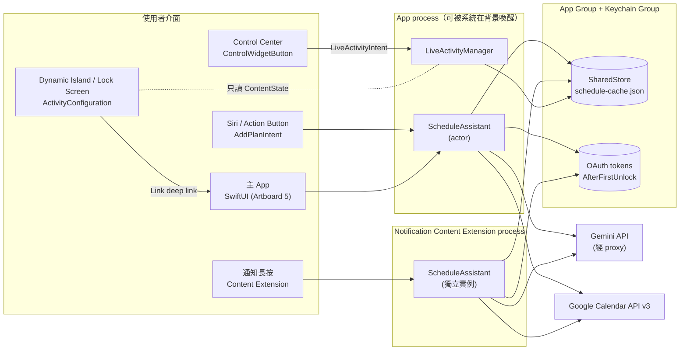
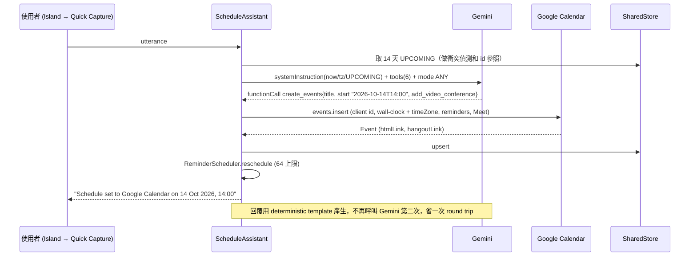

# Smart Schedule：系統架構與技術選型

> 核心理念：常駐背景、不打擾、輸入極快。
> 架構一句話：三個 process、一個 App Group、一條 AI 管線。凡是 iOS 不允許「原地」完成的事，都改成「看起來像原地」的路徑來完成。

---

## 1. 決定架構的平台限制

下表是設計圖與 iOS 實際行為的對照。每一列都直接改變了程式碼的寫法。

| 設計需求 | iOS 實際行為 | 本專案對策（檔案） |
|---|---|---|
| 從控制中心按時鐘圖示後，不開 App 就讓動態島就緒（Artboard 3 紅圈） | iOS 18 的 `ControlWidgetButton` 可以執行 `LiveActivityIntent`。系統會在背景啟動 App process 來跑 `perform()`，不會把 App 開到前景，所以可以在這裡直接 `Activity.request` | `Shared/Intents/SummonScheduleIntent.swift`、`Widgets/SmartScheduleControl.swift` |
| 動態島展開後有 TextField、麥克風、送出（Artboard 3） | Live Activity 只支援 `Button`、`Toggle`（App Intent）和 `Link`。不能放 TextField、叫不出鍵盤、不能捲動。Expanded 和 Lock Screen 的高度上限都是 160 pt | 輸入列做成「看起來像輸入框的 deep link 膠囊」。點下去開啟 **Quick Capture**（Artboard 4）：一張外形像動態島、鍵盤已彈出的卡片，從島的位置放大出現。完全不開 App 的輸入改走 Siri、Action Button、Spotlight（`AddPlanIntent`） |
| 動態島常駐 | 一個 Live Activity 最多活躍 8 小時，之後在鎖定畫面再留最多 4 小時。從背景啟動只有兩條路：`LiveActivityIntent`，或 APNs push-to-start（iOS 17.2 起） | 有後端時：用 push-to-start 自動續命（`LiveActivityManager.observePushTokens`）。沒有後端時：每次開 App、按控制中心、問 Siri 都重建一次 |
| 動態島顯示一週日曆 | ActivityKit 的內容（static 加 dynamic）不能超過 4 KB。畫面渲染時不能連網 | `LiveActivityStateBuilder` 先壓縮：每天最多 2 個 chip、標題截短，超過預算就自動降一級 |
| 「21 MIN」倒數 | 不靠推播也會自己跳動的文字，只有 `Text(timerInterval:)` 和日期樣式 | `countdownFrom`／`countdownTarget`，由 builder 保證範圍永遠合法 |
| 長按 Google 日曆送來的通知，原地展開（Artboard 1） | **App 不能擴充別的 App 的通知。** Google Calendar App 的推播，Smart Schedule 碰不到 | 改由 Smart Schedule 自己發提醒（本地通知或 APNs），並把 category 綁到 Content Extension。建議使用者關掉 Google Calendar iOS App 的通知（網頁和桌機上的 Google 彈窗照常保留） |
| 在通知裡直接輸入 | Content Extension 加上 `UNNotificationExtensionUserInteractionEnabled`，再用 `UNTextInputNotificationAction` 讓使用者打字。文字送出後，extension 內的 `didReceive(_:completionHandler:)` 直接處理，回傳 `.doNotDismiss` 讓卡片保持展開 | `NotificationContent/NotificationViewController.swift` |
| 前一天、24 小時、1 小時、30 分鐘前提醒 | 每個 App 最多只能有 64 個待發的本地通知，超過的會被**默默丟掉** | `ReminderScheduler` 採滾動視窗：只排最近的觸發點，留 2 格給貪睡。Routine 預設只提醒一次 |
| 和 Google 雙向同步 | BGAppRefresh 什麼時候跑由系統決定，不是即時通道 | 拉取：開到前景、每次寫入後、BG refresh 時都重抓。要即時：後端 `events.watch`（webhook），再發 silent push 或更新 Live Activity |
| 在 App 內呼叫 Gemini | 打包進 IPA 的 API key 幾分鐘就能被挖出來 | 正式版改走 proxy（Cloud Run，或 Firebase AI Logic 加 App Check）。程式裡 `GEMINI_BASE_URL` 一行就能切換 |
| Gemini 模型版本 | 2.5 系列已經過了公告的最早關機日（2026-10-16）；3.x 的模型 ID 換得很快 | `GEMINI_MODEL_ID` 由 xcconfig 注入，預設 `gemini-3.5-flash`。**上線前務必到 deprecations 頁確認** |
| Gemini 3 多輪 function calling | 要把 thought signature 原樣傳回，否則回 400 | `GeminiTurn` 把模型回傳的 content 以 raw JSON 原封保存（`Shared/AI/GeminiClient.swift`） |

---

## 2. Process 與資料邊界

**為什麼有三個 target：**
| Target | 內容 | 不放進其他 target 的理由 |
|---|---|---|
| `SmartSchedule`（App） | SwiftUI 主畫面、Quick Capture、Google 登入（PKCE）、語音、BGTask、App Intents | `ASWebAuthenticationSession` 和 `UIApplication` 在 extension 裡不能用 |
| `SmartScheduleWidgets` | Live Activity（動態島＋鎖定畫面）、Control Center 控制項 | Widget extension 有記憶體上限，所以只編譯 Models、Storage、LiveActivity、Intents、DesignSystem，不放 AI 和網路程式碼 |
| `SmartScheduleNotificationContent` | 「長按展開」的對話 UI 和完整的 AI → Calendar 管線 | 必須能在鎖定畫面上獨立完成寫入，不依賴 App |

**跨 process 共享：**
- **App Group**（`group.com.smartschedule.shared`）：放 `SharedStore`，一個 JSON 檔，每次存取都包在 `NSFileCoordinator` 裡。檔案大約 50 到 150 KB；profiling 證明有瓶頸才換成 SQLite。
- **Keychain access group**：存 OAuth refresh token，屬性設 `kSecAttrAccessibleAfterFirstUnlock`，這樣鎖定畫面上的 extension 也讀得到。
- **Extension 寫入後，Live Activity 不會立刻更新**：extension 改不了 App 的 activity。要等下次 App 被喚醒（BG refresh、Control、Siri），或由後端發 Live Activity push。

---

## 3. 各介面的框架選型

### 3.1 控制中心：WidgetKit `ControlWidget`（iOS 18+）
- `StaticControlConfiguration` 搭配 `ControlWidgetButton(action: SummonScheduleIntent())`。
- 控制項只能顯示 SF Symbol 或自訂 symbol（`.symbolset`）。要和 App icon 的時鐘一模一樣，得把它匯出成 custom symbol。
- 同一個控制項可以放進控制中心、鎖定畫面左下和右下的按鈕位，以及 Action Button。
- 開發者論壇上有人回報「從 widget 或 control 觸發的 intent 沒能啟動 Live Activity」，可能和 Xcode 16.0 時期的版本有關。**要在實機上驗證。**

### 3.2 動態島：ActivityKit 加 WidgetKit `ActivityConfiguration`
- 版面配置（`Widgets/ScheduleLiveActivity.swift`）：
  - Compact：⏰ 加短標題（leading），倒數（trailing）。
  - Expanded：`.leading` 放時鐘、`.center` 放標題、`.trailing` 放「21 MIN」膠囊；`.bottom` 放一週微型日曆和輸入膠囊。
  - Minimal：只有 ⏰。
- 互動：`Link` 用於 deep link（`smartschedule://compose`、`?mode=voice`）；`Button(intent:)` 用於不開 App 的動作。
- 推播：`pushType: .token` 搭配 `NSSupportsLiveActivitiesFrequentUpdates`；APNs 的 `apns-push-type: liveactivity`，topic 是 `<bundle>.push-type.liveactivity`。

### 3.3 通知：UserNotificationsUI Content Extension
- 細節見 [`NOTIFICATIONS.md`](NOTIFICATIONS.md)。
- 如果改用遠端推播，可以另加 Notification Service Extension（`mutable-content: 1`），在送達前補上 category 和最新資料。

### 3.4 主 App：SwiftUI 加 Observation（`@Observable`）
- iOS 18 起跳。`RootView` 疊出 Quick Capture overlay，動畫是 `.scale(anchor: .top)`，看起來像從動態島「長」出來。
- 背景工作：`.backgroundTask(.appRefresh(...))`（SwiftUI 的 scene modifier）。

### 3.5 零 UI 輸入：App Intents
- `AddPlanIntent`：用 `@Parameter` 搭配 `requestValueDialog`，由 Siri 或 Shortcuts 開口問「What should I schedule?」，全程不開 App。
- `AppShortcutsProvider` 讓 Spotlight 和 Siri 不用設定就能叫出來。指派給 Action Button，就是一顆實體的「排程鍵」。

### 3.6 AI：Gemini REST function calling
- 細節見 [`GEMINI_FUNCTION_CALLING.md`](GEMINI_FUNCTION_CALLING.md)。
- 不依賴任何 SDK，所以 notification extension 也能直接用同一份 client。

### 3.7 行事曆：Google Calendar API v3 REST 加 OAuth PKCE
- 細節見 [`GOOGLE_CALENDAR_SYNC.md`](GOOGLE_CALENDAR_SYNC.md)。
- 不用 GoogleSignIn SDK：用 `ASWebAuthenticationSession` 加 PKCE 登入，refresh 就是一個表單 POST，任何 process 都能做。

---

## 4. 端到端流程：「明天下午兩點跟 Joe 開線上會議」

**延遲預算（目標值，要在實機上量）：** Gemini Flash（`thinkingLevel: low`）約 1 到 2.5 秒，Calendar insert 約 0.3 到 0.7 秒，本地處理不到 50 毫秒，總計目標不超過 3 秒。長期計畫是 4 路並行 insert，每多一批 4 個 series 大約多 0.5 秒。

---

## 5. 安全與可靠性

| 風險 | 對策 |
|---|---|
| API key 外洩 | 正式版改走 proxy。proxy 驗證 App Check／DeviceCheck，並依使用者做 rate limit |
| Prompt injection（別人寄來的邀請，標題裡寫指令） | 行事曆資料放在 system prompt 的 DATA 區塊，並移除分隔字元；模型只能呼叫 6 個白名單函式；`modify_event`／`delete_events` 的 id 一定要在本地 cache 裡找得到才放行；批次刪除要使用者按確認 |
| 網路重試造成重複事件 | Event ID 由確定的 seed 算出（base32hex）；伺服器回 409 就當作已經寫過 |
| Token 過期 | OAuth consent screen 在 Testing 狀態時，refresh token **7 天就失效**。`calendar.events` 屬於 sensitive scope，正式上線要過 Google 的 App 驗證 |
| 跨 process 同時寫檔 | 用 `NSFileCoordinator` 加 atomic write |

---

## 6. 打破框架的建議（可選）

1. **用通知當鍵盤（完全不開 App 的動態島輸入）。** 動態島上的 `Button(intent:)` 觸發一個 `LiveActivityIntent`，它發出一則 `SS_COMPOSE` 通知；使用者把通知往下拉，直接用系統輸入框打字，回覆由 Content Extension 原地處理。代價是比 deep link 多一個手勢，換來的是 App **永遠不會出現**。適合做成「隱形模式」開關。
2. **雙引擎解析。** iOS 26 有 Apple 的 Foundation Models（裝置上約 3B 參數，支援 guided generation 和 tool calling）。單一事件交給它解析：離線、零成本、延遲在 1 秒內。只有長期計畫才送 Gemini。雲端費用和延遲可以降一個數量級。限制：只支援有 Apple Intelligence 的機型。
3. **EventKit 混合同步。** Artboard 1 頂部那行字其實就是 EventKit 權限說明。如果使用者已經在 iOS 設定裡加了 Google 帳號，EventKit 的讀取是即時且離線的，還有 `EKEventStoreChanged` 通知，等於不用後端就有接近即時的反向同步。Google API 只負責 EventKit 做不到的寫入：Meet 連結、`extendedProperties`、idempotent ID。
4. **自我修正的計畫。** 把每次的 milestone 當成回饋點：使用者在通知裡回「這週只練了 2 次」，Gemini 就用 `modify_event`（`all_occurrences`）重排接下來的那一段。「計畫」從一次性產出變成一個閉環控制系統。
5. **把動態島當作決策佇列，而不只是下一個行程。** 例如顯示「回覆 Joe？」並附上「是／稍後」按鈕（`Button(intent:)`）。把島上的空間留給「下一個需要你決定的事」，這才真正做到不打擾：只在需要你時出現。
6. **提醒等級隨期限升級。** deadline 類事件的 `interruptionLevel` 依剩餘時間調整：還早時用 `.passive`，接近時用 `.active`，最後一小時用 `.timeSensitive`。讓 Focus 模式替你過濾干擾，而不是你去過濾 App。

---

## 7. 只能在實機上驗證的項目

- [ ] 控制中心 → `LiveActivityIntent` → `Activity.request`，在已鎖定和未鎖定兩種狀態下都要測。
- [ ] Content Extension 裡的 inline `TextField` 能不能取得鍵盤焦點。保底方案是系統的文字輸入 action。
- [ ] 不同機型上 expanded island 是否超出 160 pt，例如 Pro Max 和標準尺寸、粗體字、動態字級。
- [ ] `GEMINI_MODEL_ID` 是否仍有效，以及 `thinkingLevel` 參數是否被該模型接受。
- [ ] Testing 模式下 7 天 refresh token 到期後，重新登入的流程。
