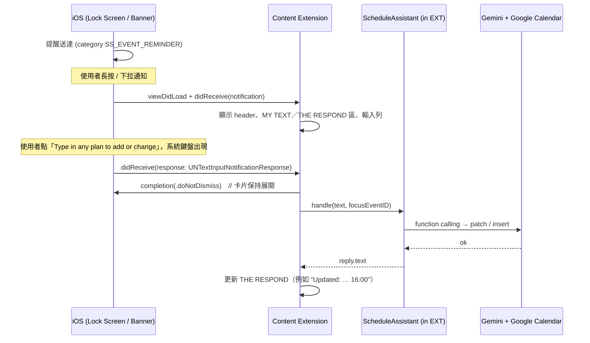

# 通知原地互動：「HOLD MESSAGE TO SPAWN」（Artboard 1）

程式碼位置：`NotificationContent/`（UI 和流程）、`Shared/Notifications/`（category 和排程）

## 1. 先講清楚做不到的事

**Google Calendar App 發出的通知，Smart Schedule 不能擴充，也讀不到。** iOS 的 Notification Content Extension 只會套用在「本 App 送出、而且 `categoryIdentifier` 列在 extension Info.plist 裡」的通知。

所以 Artboard 1 中「MESSAGE SENT FROM GOOGLE CALENDAR」這一步要改寫成：
> Google Calendar 的事件資料同步到 Smart Schedule，再由 Smart Schedule 自己發出提醒。這則提醒可以長按展開。

通知來源有兩種：
| 來源 | 做法 | 適用情境 |
|---|---|---|
| 本地通知（已實作） | `ReminderScheduler` 從 `SharedStore` 讀出事件，排定 `UNCalendarNotificationTrigger` | 不需要後端；MVP 階段 |
| 遠端推播 | 後端訂閱 `events.watch`，計算提醒時間，發 APNs，並設定 `category` 與 `mutable-content: 1` | 多裝置；事件在其他地方被修改時，提醒時間也能立刻更新 |

## 2. 互動流程



**FOCUS 機制：** 通知的 `userInfo.ssEventId` 會變成 prompt 裡的 FOCUS 區塊。使用者只要說「延後 30 分鐘」或「改成線上」，不必說出事件名稱，模型就知道「it」指的是誰。

## 3. Info.plist（由 project.yml 產生）

```yaml
NSExtensionPointIdentifier: com.apple.usernotifications.content-extension
NSExtensionPrincipalClass: $(PRODUCT_MODULE_NAME).NotificationViewController   # 不用 storyboard
NSExtensionAttributes:
  UNNotificationExtensionCategory: [SS_EVENT_REMINDER, SS_COMPOSE]
  UNNotificationExtensionInitialContentSizeRatio: 0.75
  UNNotificationExtensionUserInteractionEnabled: true    # 沒開的話，按鈕和輸入框都不會有反應
  UNNotificationExtensionDefaultContentHidden: true      # header 由我們自己畫（「31」圖示加大寫標題）
```

## 4. 兩條輸入路徑

| 路徑 | 可靠度 | 說明 |
|---|---|---|
| `UNTextInputNotificationAction`（系統輸入框） | **保證可用** | 在鎖定畫面上也能用；回覆會送到 extension 的 `didReceive(_:completionHandler:)`；麥克風就是鍵盤上的聽寫鍵 |
| 卡片內的 inline `TextField` | 要在實機上驗證 | 需要 user interaction enabled；extension 裡能不能取得鍵盤焦點，各 iOS 版本表現不一。拿到焦點就是最接近設計稿的體驗 |

另外，如果使用者在**收合狀態**的 banner 上直接回覆（沒有展開 extension），回覆會送到 `AppDelegate.userNotificationCenter(_:didReceive:)`，App 在背景被喚醒，跑同一條管線，再發一則 `SS_COMPOSE` 通知回報結果。這則回報通知本身也能長按繼續對話。

## 5. 提醒排程與 iOS 的硬限制

| 限制 | 對策 |
|---|---|
| 每個 App 最多 64 個待發本地通知（超過的會被默默丟掉） | 滾動視窗：所有候選觸發點依時間排序，只排最前面的 64 減去 nudge 數再減 2；每次寫入、啟動、BG refresh 後重排 |
| Focus 模式會擋掉通知 | 距開始 30 分鐘以內的提醒用 `interruptionLevel = .timeSensitive`（需要 `com.apple.developer.usernotifications.time-sensitive` entitlement，已加在 project.yml） |
| 重複觸發的 trigger 不能設定結束日 | 計畫的每日 nudge 用 `repeats: true`，下次重排時檢查 `endsOn`，過期就移除 |
| Extension 有記憶體上限 | UI 用 SwiftUI hosting；管線只用 `URLSession`，沒有其他 SDK |

## 6. 遠端推播範例（換成後端發送時用）

```json
{
  "aps": {
    "alert": { "title": "Online meeting with Joe", "subtitle": "In 30 min", "body": "15:30 · Google Meet" },
    "category": "SS_EVENT_REMINDER",
    "thread-id": "ss0k3p…",
    "interruption-level": "time-sensitive",
    "mutable-content": 1
  },
  "ssEventId": "ss0k3p…"
}
```
`mutable-content` 讓 Notification Service Extension 有機會在送達前補上最新的時間和地點。這個 extension 本專案還沒建立，屬於選配。

## 7. 實機測試清單

- [ ] 鎖定畫面長按 → 展開 → 用系統輸入框輸入 → 卡片保持展開，並顯示回覆。
- [ ] 解鎖狀態在其他 App 裡收到 banner → 下拉 → 同上。
- [ ] 在收合的 banner 直接回覆 → App 在背景處理 → 收到結果通知。
- [ ] Inline TextField 能不能取得焦點（決定是否把它當主要輸入方式）。
- [ ] 64 個上限：建立 30 個會議（每個 4 個提醒）後，最近的提醒仍然都在排程裡。
