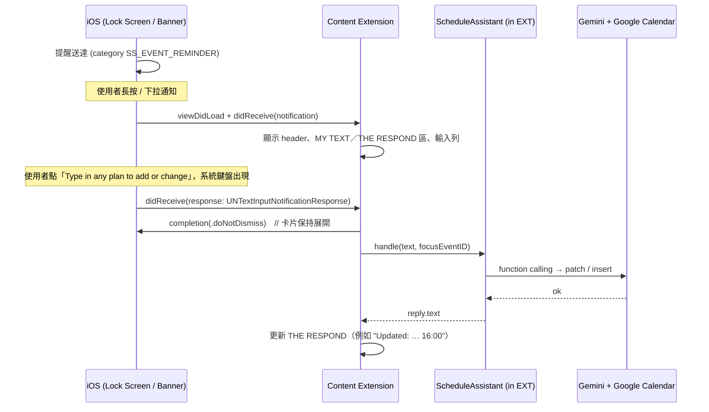

# 通知：提醒、每日摘要與「HOLD MESSAGE TO SPAWN」（Artboard 1）

程式碼位置：
- `Shared/Notifications/ReminderPlanner.swift`：排什麼、多大聲、怎麼塞進 64 個名額（純邏輯，全部有單元測試）
- `Shared/Notifications/ReminderScheduler.swift`：把計畫交給 `UNUserNotificationCenter`
- `Shared/Notifications/BriefingBuilder.swift`：早晨摘要與晚間預覽的文字
- `Shared/Notifications/ReminderEngagement.swift`：從「略過」學習
- `Shared/Models/AppPreferences.swift`、`Shared/Storage/PreferencesStore.swift`：設定 › 通知 的所有值
- `NotificationContent/`：長按展開後的對話 UI

## 1. 先講清楚做不到的事

**Google Calendar App 發出的通知，Smart Schedules 不能擴充，也讀不到。** iOS 的 Notification Content Extension 只會套用在「本 App 送出、而且 `categoryIdentifier` 列在 extension Info.plist 裡」的通知。所以 Artboard 1 中「MESSAGE SENT FROM GOOGLE CALENDAR」這一步要改寫成：
> Google Calendar 的事件資料同步到 Smart Schedules，再由 Smart Schedules 自己發出提醒。這則提醒可以長按展開。

提醒的文字（`ReminderScheduler.request`）：標題是行程名稱，副標是多久後開始（「30 分鐘後」「明天」），內文第一行是時間和地點（「14:48 · 會議室」，全天行程是「全天」），第二行是「長按以編輯或延後行程」（`ReminderScheduler.holdHint`，英文 "Hold to edit or snooze"），告訴使用者長按可以輸入要改的內容或延後 10 分鐘。長按展開後的卡片標題列不重複這一行（`ReminderScheduler.bodyWithoutHoldHint`）。每日摘要和計畫提醒沒有這一行。

其他 iOS 不允許、所以設定頁只能用文字說明的事：

| 做不到 | 原因 | App 的做法 |
|---|---|---|
| 替使用者關掉 Google Calendar App 的通知 | App 不能改其他 App 的設定 | 「由誰發送提醒」的註腳提醒使用者自己去關，避免重複提醒 |
| 動態島在 App 關著時，自動在每個行程前出現 | App 在背景不能 `Activity.request()` | iOS 26：`Activity.request(…, start:)` 排程啟動；iOS 18：1.0 只在 App 執行時（提前時間內或行程進行中）開始，之後關掉 App 也留著。APNs push-to-start（第 8 節）的程式保留給之後的版本（`AppConstants.pushToStartEnabled = false`） |
| 直接打開系統「專注模式」設定頁 | 沒有公開的 URL | 設定頁說明路徑：設定 App › 專注模式 › 選一個模式 › 加入過濾條件 › Smart Schedules |
| 在 App 裡加控制中心按鈕、動作按鈕、鎖定畫面捷徑 | 只有使用者能加 | 設定 › 捷徑與 Siri 的說明頁 |

通知來源有兩種：
| 來源 | 做法 | 適用情境 |
|---|---|---|
| 本地通知（已實作） | `ReminderScheduler` 從 `SharedStore.visibleEvents` 讀出事件，排定 `UNCalendarNotificationTrigger` | 不需要後端；MVP 階段 |
| 遠端推播 | 後端訂閱 `events.watch`，計算提醒時間，發 APNs，並設定 `category` 與 `mutable-content: 1` | 多裝置；事件在其他地方被修改時，提醒時間也能立刻更新 |

## 2. 由誰發送提醒（設定 › 通知）

| 模式 | Smart Schedules 本地提醒 | 新增或修改的行程寫到 Google 的彈出提醒 | 每日摘要與計畫提醒 |
|---|---|---|---|
| 兩者都用（預設，等於原本的行為） | 有 | `useDefault: false`，覆寫值 = 使用者要求的或該類別的預設 | 有 |
| 只用 Smart Schedules | 有 | `useDefault: false`、**空的覆寫值**（其他裝置不會跳 Google 提醒）；私有屬性 `ssReminders` 記住原本想要的提醒，本機提醒照樣正確 | 有 |
| 只用 Google 日曆 | 沒有（重排時把已排的移除） | 同「兩者都用」 | 有 |

- 切換模式不會回頭改寫已存在的行程（註腳寫的是「新行程」）。
- `ReminderPolicy(preferences:)` 依模式設定 `writesGooglePopups`；`googleReminders` / `googleAllDayReminders` 在「只用 Smart Schedules」時回傳空覆寫值。
- 「只用 Google 日曆」時，提醒無法原地回覆，緊急程度、安靜時段、每日上限三個區塊在設定頁會停用。

## 3. 預設提醒、緊急程度、安靜時段

**預設提醒**（使用者沒指定時用；每個行程最多 5 個，Google 的上限）：

| 類別 | 預設 | 說明 |
|---|---|---|
| 行程 event | 1 天、1 小時、30 分鐘、開始時 | 會議與約會 |
| 截止日 deadline | 1 天、1 小時 | |
| 待辦事項 task | 1 小時 | |
| 例行活動 routine | 30 分鐘 | 長期計畫的課程，一週 3–5 次，提醒太多會被習慣性忽略 |
| 全天行程與計畫檢查點 | 前一天 09:00 | 存成「行程當天 00:00 往前 900 分鐘」 |

全天提醒用「牆上時間」計算（往前幾天、那天幾點），所以跨越夏令時間時還是 09:00，不會變成 08:00 或 10:00。本機現在也會替全天行程發提醒（以前只寫到 Google）。

**緊急程度**（每個類別各自設定）：

| 選項 | `interruptionLevel` | 聲音 | 說明 |
|---|---|---|---|
| 自動（預設） | 開始前 30 分鐘以內 `.timeSensitive`，其餘 `.active` | 有 | 原本的規則 |
| 時效性 | `.timeSensitive` | 有 | 會穿透專注模式；需要 `com.apple.developer.usernotifications.time-sensitive` entitlement（已在 project.yml） |
| 標準 | `.active` | 有 | |
| 安靜 | `.passive` | 無 | 直接進通知中心，不亮螢幕 |

`relevanceScore`：時效性 1.0、標準 0.5、安靜 0.2。

**安靜時段**（預設關閉，22:00–07:00，可跨午夜）：觸發時間落在時段內的提醒一律以 `.passive`、無聲送達，**不會被丟掉**。判斷用設定的時區（「跟隨這支 iPhone」或固定時區）。

## 4. 每日摘要

| 項目 | 內容 |
|---|---|
| 早晨摘要 | 預設開啟、07:30；標題「今天」；列出當天行程 |
| 晚間預覽 | 預設關閉、21:00；標題「明天」；列出隔天行程 |
| 識別碼 | `ss.briefing.morning.<yyyy-MM-dd>`、`ss.briefing.evening.<yyyy-MM-dd>`，日期是**送達那天** |
| 排幾天 | 今天（時間還沒過才排）、明天、後天：最多 6 則 |
| 內文 | 第一行「4 個行程，第一個在 09:00 開始」；接著最多 6 行「09:00 標題」（全天行程「全天 · 標題」）；超過時「還有 2 個」；被每日上限擋下的提醒列在「未發送提醒：…」 |
| 類別 | `SS_COMPOSE`（可長按回覆），`userInfo.ssBriefingDay` = 摘要描述的那天，`threadIdentifier = "ss.briefing"` |
| 音量 | `.active`、無聲；落在安靜時段內則 `.passive` |

**內容在排程當下就寫好**（本地通知送達時不能再執行程式）。每次 `reschedule()` 都會重建：寫入、同步、啟動 App、背景更新、設定變更之後都會跑。所以如果使用者在別的裝置改了行程、而這支 iPhone 還沒同步，摘要會是舊的。當天沒有行程、也沒有被擋下的提醒，就不排摘要。

## 5. 每日提醒上限

預設關閉；開啟時每天最多 N 則（1–50，預設 10）。依觸發時間的「當地日期」分組，每天保留優先順序最高的 N 則，同順序先觸發的優先：

1. 行程開始時的提醒（0 分鐘）
2. 截止日
3. 行程的其他提醒
4. 待辦事項
5. 例行活動

（全天提醒算在各自類別。）被擋下的提醒列在**當天的早晨摘要**；如果早晨摘要關閉或時間已過，就不發送。上限先套用，再算 64 個名額；摘要與計畫提醒不算在上限內。

## 6. 64 個上限與排程順序

iOS 每個 App 最多保留 64 個待發本地通知，超過的會被默默丟掉。`ReminderPlanner.plan` 依序分配：

1. 保留 2 個給「延後 10 分鐘」（`ss.reminder.snooze.<uuid>`，重排時不動）
2. 進行中的計畫每日提醒（`ss.nudge.<planID>`，重複觸發；`endsOn` 過了就在下次重排時移除）
3. 每日摘要（最多 6 則）
4. 其餘名額給提醒，最早觸發的優先

`reschedule()` 先移除所有 `ss.reminder.`（延後的除外）、`ss.nudge.`、`ss.briefing.` 開頭的待發通知，再全部重新加入。提醒只用「行事曆通知開啟」的行程（`EventAudience.reminders`：隱藏的行事曆、專注模式過濾掉的行事曆、關閉通知的行事曆都不提醒）；摘要用畫面上看得到的行程（`.display`）。

## 7. 從「略過」學習

- `SS_EVENT_REMINDER` 註冊了 `.customDismissAction`，使用者把提醒滑掉時，回應會送到 `AppDelegate`（或已展開的 content extension），呼叫 `ReminderEngagement.record(response)`。
- 每則提醒的 `userInfo` 帶著 `ssKind`、`ssOffset`、`ssAllDay`、`ssFromDefaults`。**只有來自預設值的提醒**（`ssFromDefaults == true`）才計算；使用者自己指定的提醒、延後的副本、摘要都不算。
- 以（類別, 提前時間）為單位計數：滑掉 +1；點開、延後、回覆歸零。連續 5 次滑掉、而且這個提前時間還在該類別的預設裡，就建立一則建議（每個 key 一輩子只問一次）：
  > 你已連續 5 次略過行程的「1 天前」提醒。要停止發送嗎？［停止］［保留］
- 建議出現在聊天（App 啟動或回到前景時）和 設定 › 通知 › 建議。按「停止」才會把那個提前時間從預設移除（全天提醒則關閉），並在「助理記得的事」記一筆「從你的習慣學到」；**沒有點按就不改任何東西**。

## 8. 動態島（Dynamic Island）

- 設定 › 通知 › 動態島「顯示下一個行程」：30 分鐘前（預設）、15 分鐘前、10 分鐘前、5 分鐘前、關閉。舊版存的 1 小時、2 小時讀成 30 分鐘。
- **一個行程一個 Live Activity**，只代表「即將開始或進行中」的行程：開始前「提前量」出現，行程結束後從鎖定畫面消失前再留 10 分鐘。沒有行程時動態島不出現；控制中心按鈕改為打開快速輸入（`OpenQuickCaptureIntent`）。
- `ActivityScheduler.reconcile()`（`Shared/LiveActivity/ActivityScheduler.swift`）在 App 回到前景（`LiveActivityManager.summonIfDue`）、每次寫入或同步後、以及 BGAppRefresh（`refreshIfRunning`）時執行：
  - 規劃（`ActivityPlanner`，純函式、有單元測試）：未來 48 小時內開始、有時間、未完成、不是草稿的行程，最近的優先，最多 `ActivityPlanner.maxPending`（8，待真機測試回填）。觸發時間 = 開始 − 提前量；結束時間 = min(行程結束, 觸發 + 8 小時)，超過 8 小時的行程直接截斷。
  - **iOS 26 起**：`Activity.request(…, style: .standard, alertConfiguration:, start: 觸發時間)` 排程啟動（狀態 `.pending`），App 關著也會準時出現。系統規定排程啟動一定要附提醒（標題 = 行程名稱，內文「%lld 分鐘後開始」）。
  - **iOS 18（1.0）**：App 不能排程，也不能在背景啟動；`AppConstants.pushToStartEnabled = false`（`ActivityPlanner.pushToStartStep` 是 `.off`）：不要求 push-to-start token、不寫 `push-to-start.json`、不上傳，伺服器不存任何行程。即時動態只在提前時間內或行程進行中 App 執行時立即啟動，之後關掉 App 也留著。App 一直開著時，`ActivityScheduler` 在下一個觸發時間再跑一次（`dueWake`，只在 App 的程序（process）還在執行時有效；在背景時啟動會失敗，回到前景的那一次會補上）。
    - 之後的版本開啟 push-to-start 時：`PushToStartRegistrar.sync(token:upcomingEvents:)` 把 48 小時內的行程（ID、標題、開始時間、提前量、觸發時間，加上用預設 `JSONEncoder` 編好的 attributes 與 content-state）整份寫進 App Group 的 `push-to-start.json`，由伺服器（`server/worker/`）在觸發時間送 push-to-start。登記經 App Attest 上傳到 `POST /devices/push-to-start`，**只在有 AI 資料分享同意、而且 iOS 已給 push-to-start token 時**才帶行程；沒有同意（或撤回、清除所有資料、換到 iOS 26）時送空的登記，讓伺服器刪掉之前的標題。剛過觸發時間不到 3 分鐘、還沒出現的行程會留在登記裡，伺服器重試失敗的推播時還找得到。
  - 兩者共用：已在提前量內的行程，App 在前景時立刻啟動；行程改了（標題、時間、提前量）→ 排程中的 activity 先排好新的、成功後才 `end(nil, .immediate)` 舊的（背景裡排不了新的，就先留著舊的，下次前景再換），已顯示中的直接更新內容（移到更晚超過 3 分鐘則結束後重排；3 分鐘的寬限是給開啟 push-to-start 時伺服器和 iPhone 兩邊時鐘的誤差，伺服器在觸發時間或之後才送）；行程刪除、完成、或動態島關閉 → 立即結束；行程結束 → `end(最後內容, .after(結束 + 10 分鐘))`。使用者滑掉的 activity 不會被同一個觸發時間再叫出來；排程中但在出現前就消失的（例如重開機）會重排。
  - App 執行時觀察 `Activity.activityUpdates`，不是這次規劃啟動的 activity（iOS 26 排程的開始；開啟 push-to-start 時還有伺服器啟動的）一出現就記成「已顯示」，使用者滑掉後不會被 App 再叫出來。開啟 push-to-start 時，iOS 18 送給伺服器的 content-state 只含登記的這些行程（週列只有它們）且沒有助理的最後一句；activity 開始後 App 第一次更新時補齊。1.0 不為即時動態送任何東西給伺服器。
  - 倒數：內容在開始時過期（`staleDate` = 開始時間），畫面用 `context.isStale` 自動改成倒數到結束，不需要任何更新推播。
- 限制：1.0 不使用任何推播（沒有 APNs），開啟 push-to-start 的版本伺服器也不送結束或更新推播（規格不允許頻繁更新）。App 在行程結束時沒有執行的話，activity 要等 App 下次執行或系統 8 小時上限才結束。之後若要改善，可由伺服器用 `input-push-token` 取得更新 token 再送 `end`（需要 APNs，1.0 沒有）。
- 週列的星期順序跟著「每週起始日」：`ContentState.firstWeekday`（舊的 payload 沒有這個欄位時當作星期日）。
- 隱藏的行事曆與專注模式過濾掉的行事曆不會出現在動態島。

## 9. 專注模式過濾條件

`App/Intents/CalendarFocusFilter.swift`（`SetFocusFilterIntent`）讓使用者為每個專注模式選擇要顯示、要提醒的行事曆。專注模式開始與結束時系統會呼叫 `perform()`，App 存下過濾條件（結束時清除），然後重排提醒、更新動態島。App 不能直接打開專注模式設定頁，設定頁只說明路徑。需要在實機上驗證開啟與關閉兩次呼叫。

## 10. 互動流程



**FOCUS 機制：** 通知的 `userInfo.ssEventId` 會變成 prompt 裡的 FOCUS 區塊。使用者只要說「延後 30 分鐘」或「改成線上」，不必說出事件名稱，模型就知道「it」指的是誰。

## 11. Info.plist（由 project.yml 產生）

```yaml
NSExtensionPointIdentifier: com.apple.usernotifications.content-extension
NSExtensionPrincipalClass: $(PRODUCT_MODULE_NAME).NotificationViewController   # 不用 storyboard
NSExtensionAttributes:
  UNNotificationExtensionCategory: [SS_EVENT_REMINDER, SS_COMPOSE]
  UNNotificationExtensionInitialContentSizeRatio: 0.75
  UNNotificationExtensionUserInteractionEnabled: true    # 沒開的話，按鈕和輸入框都不會有反應
  UNNotificationExtensionDefaultContentHidden: true      # header 由我們自己畫（「31」圖示加大寫標題）
```

**擴充功能一定要明確連結 `UserNotifications.framework` 和 `UserNotificationsUI.framework`**（project.yml 裡這個 target 的 `dependencies: - sdk:`）。程式只用到 `UNNotificationContentExtension` 這個 protocol 和幾個 enum，沒有用到 UserNotificationsUI 的任何符號，所以光寫 `import UserNotificationsUI` 的自動連結會被 linker 拿掉；iOS 找不到擴充功能的 context class（`_UNNotificationContentExtensionVendorContext`），長按後只剩一個 0.75 比例的空白框，按鈕照樣出現（2026-10-18 實機）。`scripts/validate_schema.py` 檢查 project.yml，CI 用 `otool -L` 檢查建好的擴充功能真的連結了它。

擴充功能的第一個畫面只用通知本身的文字：`NotificationChatModel` 等到第一次回覆才建立助理（`ScheduleAssistant` 會讀設定檔和函式定義）。`Logger.card` 在 Console.app 記下 `viewDidLoad` 和 `didReceive`：搜尋 `SmartScheduleNotificationContent`，沒有 `viewDidLoad` 就代表 iOS 根本沒載入擴充功能。

## 12. 兩條輸入路徑

| 路徑 | 可靠度 | 說明 |
|---|---|---|
| `UNTextInputNotificationAction`（系統輸入框） | **保證可用** | 在鎖定畫面上也能用；回覆會送到 extension 的 `didReceive(_:completionHandler:)`；麥克風就是鍵盤上的聽寫鍵 |
| 卡片內的 inline `TextField` | 要在實機上驗證 | 需要 user interaction enabled；extension 裡能不能取得鍵盤焦點，各 iOS 版本表現不一。拿到焦點就是最接近設計稿的體驗 |

另外，如果使用者在**收合狀態**的 banner 上直接回覆（沒有展開 extension），回覆會送到 `AppDelegate.userNotificationCenter(_:didReceive:)`，App 在背景被喚醒，跑同一條管線，再發一則 `SS_COMPOSE` 通知回報結果。這則回報通知本身也能長按繼續對話。

## 13. 識別碼與 userInfo

| 常數（`NotificationIDs`） | 值 |
|---|---|
| `reminderPrefix` / `snoozePrefix` | `ss.reminder.<eventId>.<分鐘>` / `ss.reminder.snooze.<uuid>` |
| `nudgePrefix` | `ss.nudge.<planId>` |
| `briefingPrefix` | `ss.briefing.morning.<日期>` / `ss.briefing.evening.<日期>` |
| `UserInfo.eventID` / `planID` | `ssEventId` / `ssPlanId` |
| `UserInfo.kind` / `offset` / `allDay` / `fromDefaults` | `ssKind` / `ssOffset` / `ssAllDay` / `ssFromDefaults` |
| `UserInfo.briefingDay` | `ssBriefingDay` |
| `UserInfo.pendingBatchID` | `ssPendingBatchId`（「先問我」等待加入的行程） |

遠端推播範例（換成後端發送時用；`Tests/Simulator/reminder.apns` 可以拖進模擬器測試）：

```json
{
  "aps": {
    "alert": { "title": "Online meeting with Joe", "subtitle": "In 30 min", "body": "15:30 · Google Meet\nHold to edit or snooze" },
    "category": "SS_EVENT_REMINDER",
    "thread-id": "ss0k3p…",
    "interruption-level": "time-sensitive",
    "mutable-content": 1
  },
  "ssEventId": "ss0k3p…",
  "ssKind": "event",
  "ssOffset": 30,
  "ssAllDay": false,
  "ssFromDefaults": true
}
```
`mutable-content` 讓 Notification Service Extension 有機會在送達前補上最新的時間和地點。這個 extension 本專案還沒建立，屬於選配。

## 14. 實機測試清單

- [ ] 鎖定畫面長按 → 展開 → 用系統輸入框輸入 → 卡片保持展開，並顯示回覆。
- [ ] 解鎖狀態在其他 App 裡收到 banner → 下拉 → 同上。
- [ ] 在收合的 banner 直接回覆 → App 在背景處理 → 收到結果通知。
- [ ] Inline TextField 能不能取得焦點（決定是否把它當主要輸入方式）。
- [ ] 64 個上限：建立 30 個會議（每個 4 個提醒）後，最近的提醒、計畫提醒和摘要仍然都在排程裡。
- [ ] 「只用 Smart Schedules」：新行程在 Google 日曆網頁版沒有彈出提醒，本機提醒照常。
- [ ] 「只用 Google 日曆」：切換後待發的本機提醒全部消失，摘要仍在。
- [ ] 安靜時段 22:00–07:00：06:30 的提醒無聲進通知中心，07:00 的照常響。
- [ ] 時效性提醒在專注模式下仍會出現（需要 Time Sensitive entitlement）。
- [ ] 早晨摘要的內容在新增行程後會更新（重排）。
- [ ] 滑掉同一個預設提醒 5 次 → 回到 App 出現建議卡片；按「保留」後不會再問。
- [ ] 動態島：行程 30 分鐘內開始時打開 App 會自動出現；設定為「關閉」則不會。
- [ ] 專注模式過濾條件：開啟時只顯示並提醒選定的行事曆，結束後恢復。
